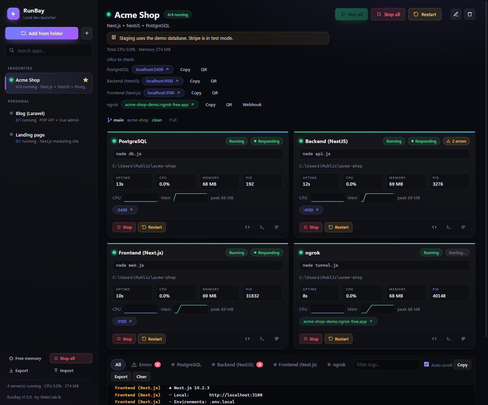
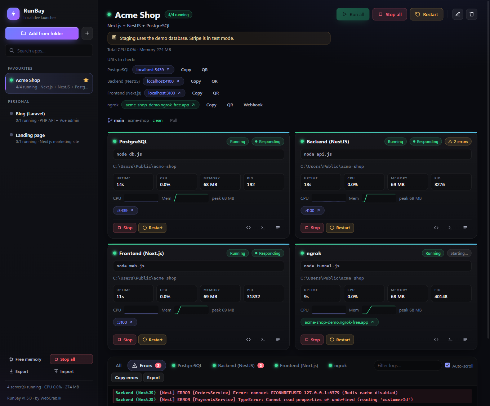
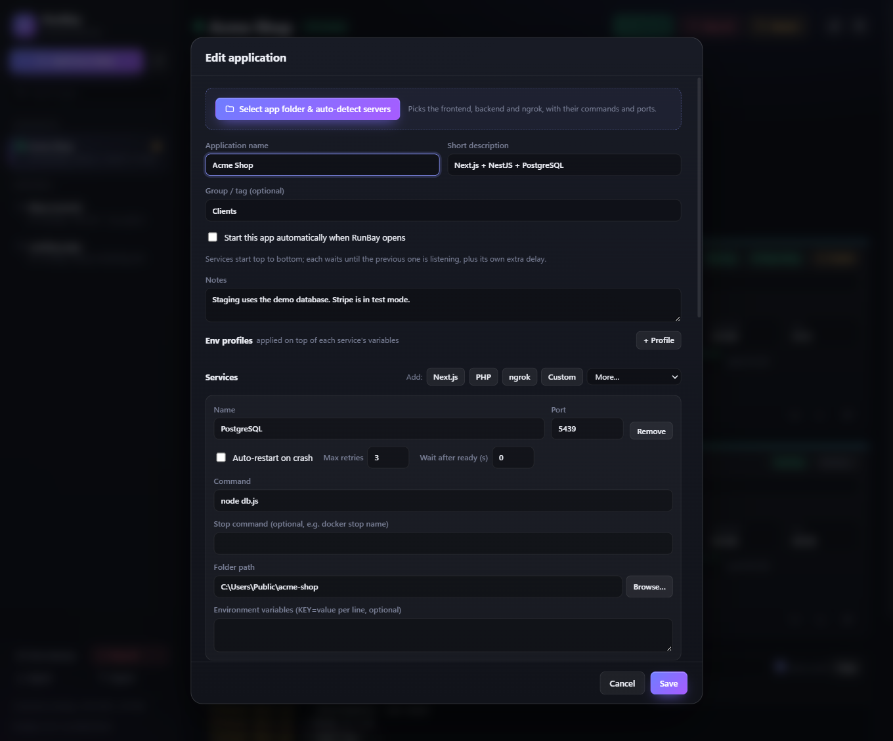

<div align="center">


# RunBay

**Run all your local dev servers from one window.**

A free, open-source **local dev server manager for Windows**. Start, stop and monitor your frontend,
backend, database and ngrok tunnel with one click, with live logs, health checks and auto-restart.
A simple GUI alternative to juggling terminals, `pm2` and `docker compose` commands.

**Works with:** Next.js · React · Vite · NestJS · Node.js · Laravel · PHP · Django · FastAPI · Flask ·
Go · .NET · Spring Boot · Docker Compose · PostgreSQL · MySQL · Redis · ngrok

[](https://github.com/Tharana/runbay/releases/latest)
[](LICENSE.txt)
[](https://github.com/Tharana/runbay/releases/latest)

</div>

<p align="center">
  
</p>

## Why RunBay?

*Looking for a localhost manager, a way to run multiple dev servers at once, or a desktop GUI for ngrok? That is what RunBay is for.*

Every project needs three terminals, a database, a tunnel and a reminder of which port is which.
RunBay replaces all of that with one app:

- **Add a folder once.** RunBay finds the servers and their commands for you.
- **Press Run all.** Everything starts in the right order and waits until each part is ready.
- **See what is going on.** Live logs, errors, health, CPU and memory for every service.

## Features

| | |
|---|---|
| **Auto-detect** | Next.js, NestJS, Node, Vite, PHP/Laravel, Django, FastAPI, Flask, Go, .NET, Spring Boot, Docker Compose and monorepos |
| **One-click start** | Run all / Stop all / Restart, ordered start with "wait until ready", auto-start on launch |
| **Live logs** | Search, copy, export, and a separate **Errors** tab with a count badge |
| **Health and stats** | Responding badge, CPU and memory sparklines, uptime |
| **Self-healing** | Auto-restart on crash, one-click fix for "port already in use" |
| **ngrok built in** | Installs itself, shows your public URL, **request inspector**, QR code for your phone, **webhook URL copier** (Stripe, Dodo, GitHub) |
| **Databases and tools** | Redis, PostgreSQL, MySQL, phpMyAdmin, Prisma Studio presets (via Docker) |
| **Git and packages** | Branch and status per app, Pull button, Install / Build buttons, warning when `package.json` changed |
| **Env profiles** | Switch between dev and staging variables per app |
| **Stay organised** | Favourites, groups, search, import / export of your app list |
| **Workspaces** | Save a set of apps as a stack and start or stop all of it with one click |
| **Quick launcher** | Global hotkey (Ctrl+Alt+R) to search and run any app from anywhere |
| **Port map** | Every port in use on the PC, who owns it, which of your apps it blocks, and a kill button |
| **Start with Windows** | Launch at login, optionally minimized to the tray, with your auto-start apps running |
| **Open in** | Browser, File Explorer, your editor (VS Code, Cursor...) and Windows Terminal, plus a copy URL button |
| **Local domains** | Open apps at `https://myshop.test` with an auto-generated trusted certificate |
| **.env editor** | Edit and compare `.env` files with secrets masked, and warnings for keys missing from `.env.example` |
| **Alerts and history** | Notifications for high CPU / memory or silent services, plus a crash and downtime timeline per app |
| **Database tools** | Connection string, backup / restore and a table browser for Docker PostgreSQL, MySQL and Redis |
| **Start order** | Say which service waits for which, drawn as a diagram |
| **Language versions** | Each app runs with the Node / Python / PHP version its `.nvmrc`, `.python-version` or `composer.json` asks for, without switching anything globally |
| **Command line** | `runbay start myshop --wait` from a terminal, script or CI; exit codes you can rely on |
| **Explain this error** | Click an error in the Errors tab and Claude explains the likely cause and fix (you review the redacted text first; bring your own API key) |
| **Smarter logs** | Level filter, highlighted stack traces, clickable file paths that open at the right line, history kept across restarts |
| **Stays out of the way** | System tray, desktop notifications on crashes, free-memory finder for idle servers |

<p align="center">
  
  
</p>

## Install

1. Download **`RunBay-Setup-x.y.z.exe`** from the [latest release](https://github.com/Tharana/runbay/releases/latest).
2. Run it, pick an install folder, and finish the wizard.
3. Open **RunBay** from your desktop or Start menu.

Prefer no installer? Download `RunBay-x.y.z-portable.exe` and run it from anywhere.

> **"Windows protected your PC"?** The installer is not code-signed yet (certificates cost money).
> Click **More info** then **Run anyway**. The code is open, so you can read or build it yourself.

## Quick start

1. Click **Add from folder** and choose your project folder.
2. Check the detected services, then **Save**.
3. Press **Run all**. Use the **URLs to check** links to open your app.

That is all. Add more apps the same way, star your favourites, and keep them in groups.

## Command line

Install it once from **Settings > Command line**, then open a new terminal:

```
runbay list                          # your apps and workspaces
runbay start myshop --wait          # start, then wait until every service is ready
runbay status myshop                # ports, health, CPU and memory
runbay logs myshop -s api -n 50 -f  # follow one service
runbay stop --all
```

Names can be shortened (`gem` finds "Gemstone ERP"); use `ws:` or `app:` to choose a workspace or an app. Exit codes: 0 ok, 1 failed or timed out, 2 bad usage or unknown name, 3 RunBay not running. In CI: `runbay start myshop --wait --timeout 180 && npm test`.

## FAQ

**Where is my data stored?**
In `%APPDATA%\runbay`. Updating or uninstalling keeps it.

**Do I need Node, PHP or Docker?**
Only the tools your own projects use. RunBay installs and updates ngrok for you.

**Does it send my data anywhere?**
No, not on its own. RunBay runs fully on your PC. Two things can reach the internet, and only when you
ask: the "Check for updates" button (downloads a small version file from this repository) and
**Explain this error** (sends the error text to Anthropic, after you review it with secrets removed,
using your own API key). The `runbay` command talks only to the app on your own PC.

**Does the command line work with the portable version?**
Use the installer version: it can add `runbay` to your PATH from Settings. The portable exe
cannot install the command.

**Which systems are supported?**
Windows 10 and 11 today. Contributions for macOS and Linux are welcome.

## Build from source

You need [Node.js](https://nodejs.org) 18 or newer.

```bash
git clone https://github.com/Tharana/runbay.git
cd runbay
npm install
npm start          # run the app
npm run dist       # build the installer into ./dist
```

## Release a new version (maintainers)

1. Change the code and test with `npm start`.
2. Raise `version` in `package.json` and add an entry at the top of `CHANGELOG.md`.
3. Run `npm run dist`.
4. Create a GitHub release tagged `vX.Y.Z` and attach `dist/RunBay-Setup-X.Y.Z.exe`
   (and the portable exe).
5. Update `latest.json` with the new version and download link, then push.
   Users get the update through **About → Check for updates**.

## Contributing

Bug reports, ideas and pull requests are very welcome.
Open an [issue](https://github.com/Tharana/runbay/issues) or send a PR, and add a line to
[CHANGELOG.md](CHANGELOG.md) for user-visible changes.

## License

[MIT](LICENSE.txt). Free to use, modify and share, including commercially.

Made with care by **[WebCrab.lk](https://webcrab.lk)**.
